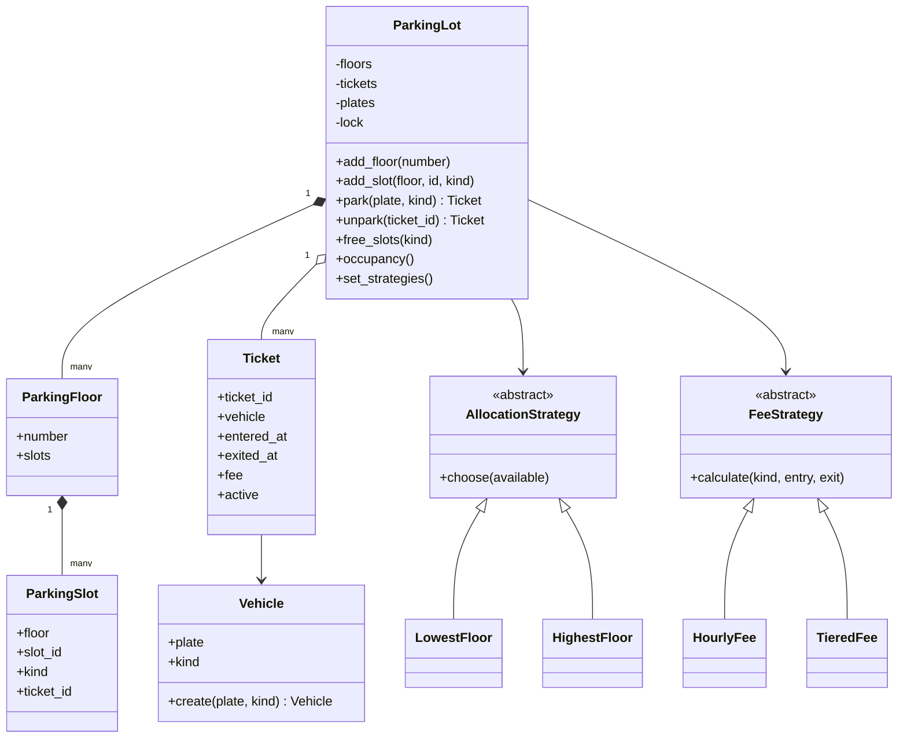

# Parking lot design

`ParkingLot` is the service boundary and owns state transitions. `ParkingFloor` groups slots. A `ParkingSlot` stores the active ticket ID; absence means free. Immutable `Vehicle` and `Ticket` values prevent a caller from changing a plate or ticket lifecycle behind the service's back. The vehicle factory method validates raw input without adding subclasses that have no distinct behavior.

Strategy interfaces separate pricing and slot selection from lifecycle management. New strategies implement these contracts without changing the park/unpark logic (open/closed principle). Model values, business orchestration, algorithms and presentation live in separate modules (single responsibility). Dependencies are supplied through the constructor so tests can inject a clock and strategies. These strategies are trusted application components, not untrusted plugins.

## Entry sequence

Validate vehicle and timestamp → acquire lock → reject duplicate plate → find compatible free slot → construct immutable ticket → occupy slot and record ticket/plate/pricing → return ticket. With no compatible slot, throw before changing state.

## Exit sequence

Acquire lock → validate active ticket and timestamp → calculate/validate fee → verify slot ownership → replace ticket with closed receipt → free slot → remove active plate/pricing association. Closed tickets remain in history. A pricing failure or backwards clock causes no partial release.

## Complexity and invariants

With S slots, the default strategy scans available slots in O(S); ticket/plate lookups use dictionaries with expected O(1) access. Occupancy reporting scans slots once per fixed vehicle type, O(S). Space is O(S + number of historical tickets). For a larger installation, index free slots by vehicle type/floor and move historical receipts to storage.

An occupied slot has exactly one active ticket. An active plate has exactly one ticket. Every ticket refers to a slot of its vehicle's type. Closed tickets cannot release a slot again. The tests exercise lifecycle errors, fee boundaries, slot reuse, alternative strategies and concurrent attempts against limited capacity.
